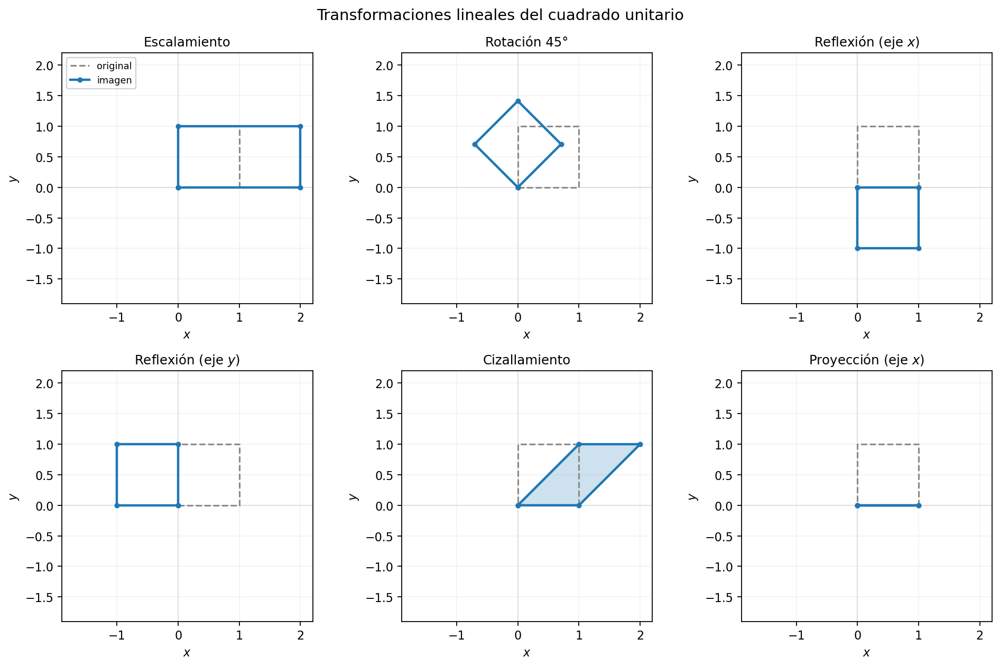
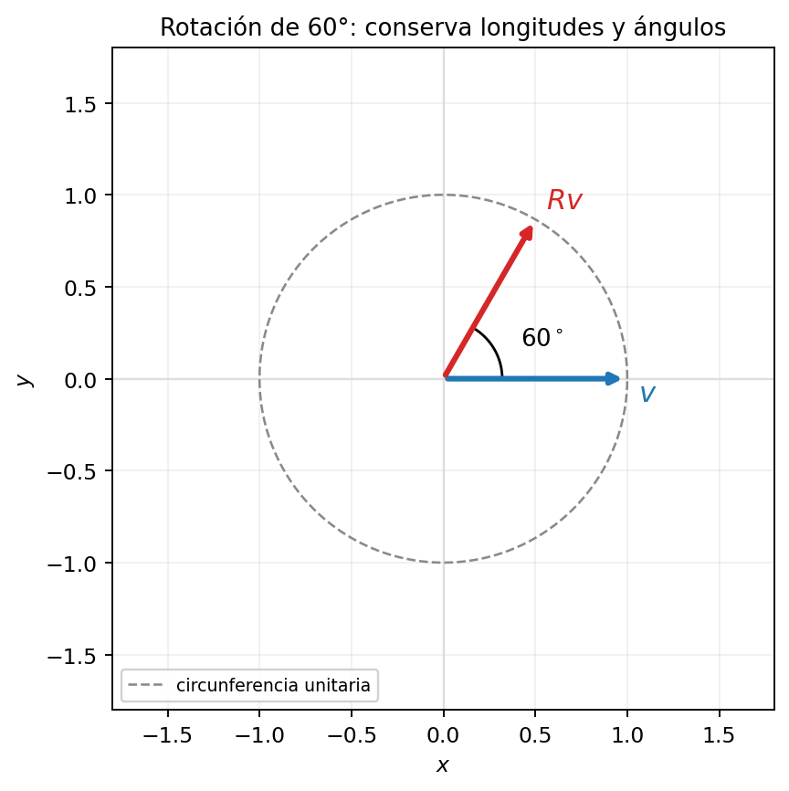
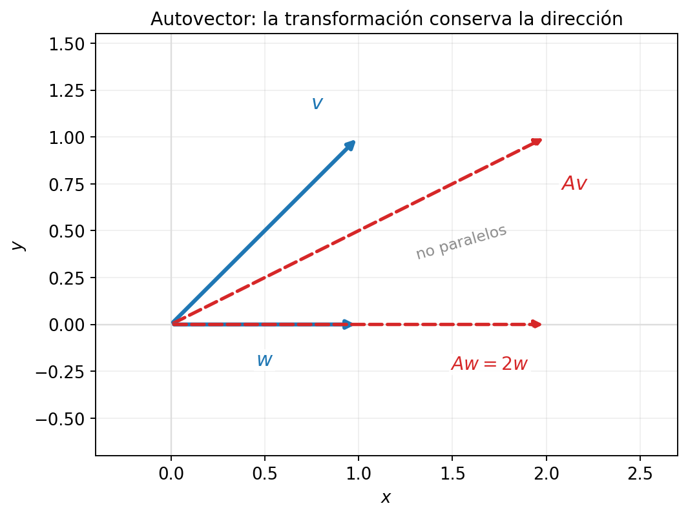
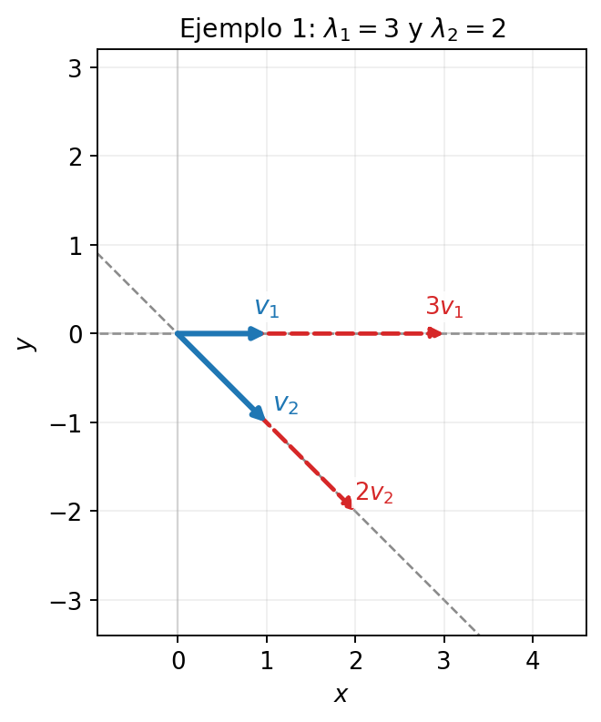
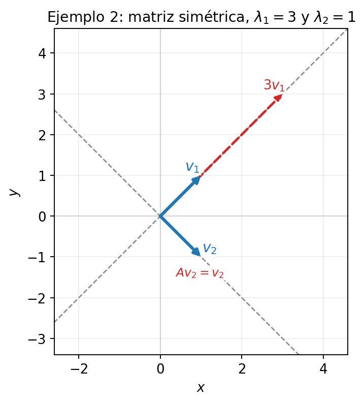
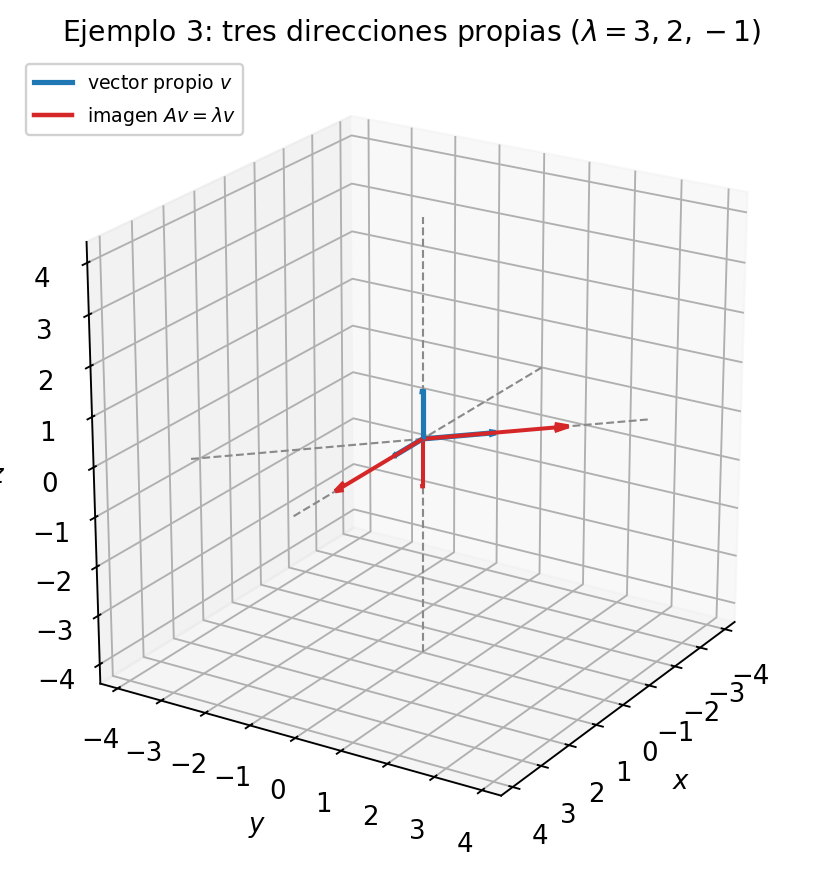
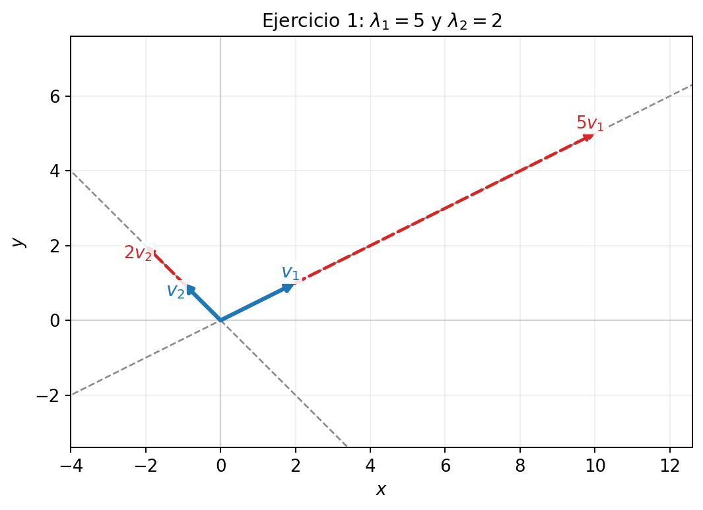
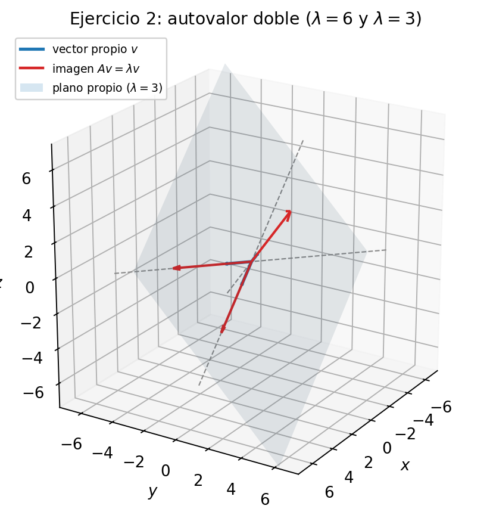

## Objetivos de la clase
Al finalizar, el estudiante será capaz de:

- Interpretar geométricamente un autovalor y un autovector.
- Calcular el polinomio característico de una matriz.
- Encontrar autovalores y espacios propios.
- Reconocer autovalores repetidos y su multiplicidad.
- Verificar los resultados mediante $Ax=\lambda x$.

## Las matrices son transformaciones lineales
Una matriz $A\in M_{2\times2}(R)$ define una transformación del plano:
$$T:R^2\to R^2, \qquad T(x)=Ax.$$
Es **lineal** porque
$$T(u+v)=T(u)+T(v), \qquad T(\alpha u)=\alpha T(u).$$
El origen queda fijo y las rectas por el origen se transforman en rectas por el origen.

## 
El cuadrado unitario se transforma en un paralelogramo (o en un segmento, si $A$ no es invertible). Cada panel muestra la figura original y su imagen.

::: {style="text-align:center; width:78%; margin-left: auto; margin-right: auto;"}

:::

## Ejemplos comunes de transformaciones
- **Escalamiento:** $\begin{pmatrix}k&0\\0&k\end{pmatrix}$ alarga o acorta por igual; $\begin{pmatrix}2&0\\0&1\end{pmatrix}$ estira solo el eje $x$.
- **Rotación** de ángulo $\theta$: $R_\theta=\begin{pmatrix}\cos\theta&-\sin\theta\\ \sin\theta&\cos\theta\end{pmatrix}$; conserva longitudes y ángulos.
- **Reflexión** respecto del eje $x$: $\begin{pmatrix}1&0\\0&-1\end{pmatrix}$; respecto del eje $y$: $\begin{pmatrix}-1&0\\0&1\end{pmatrix}$.
- **Cizallamiento:** $\begin{pmatrix}1&k\\0&1\end{pmatrix}$ desplaza horizontalmente sin cambiar la altura.
- **Proyección** sobre el eje $x$: $\begin{pmatrix}1&0\\0&0\end{pmatrix}$; colapsa el plano sobre una recta.

## Ejemplo: rotación
La rotación de $60^\circ$ conserva longitudes y ángulos, pero cambia la dirección de casi todo vector.

::: {style="text-align:center; width:52%; margin-left: auto; margin-right: auto;"}

:::

## Direcciones
Un **autovector** es una dirección especial en la que la transformación no cambia la dirección: solo alarga, acorta o invierte el vector.

::: {style="text-align:center; width:50%; margin-left: auto; margin-right: auto;"}

:::

En la figura, $w=(1,0)$ es autovector porque $Aw=2w$. En cambio, $v=(1,1)$ no lo es, porque $Av=(2,1)$ no es múltiplo de $v$.

## Definición: autovalores y autovectores
Sea $A\in M_n(R)$. Un escalar $\lambda$ es un **autovalor** de $A$ si existe un vector $x\neq0$ tal que
$$Ax=\lambda x.$$
El vector $x$ es un **autovector** asociado a $\lambda$.

##

#### Espacio propio
Para cada autovalor $\lambda$, el conjunto de todos sus autovectores (junto con el vector cero) es
$$E_\lambda=\ker(A-\lambda I)=\{x: (A-\lambda I)x=0\}.$$
Es un subespacio vectorial de $R^n$.

#### Observación
Si $x$ es autovector, cualquier múltiplo no nulo $\alpha x$ también lo es:
$$A(\alpha x)=\alpha Ax=\alpha\lambda x=\lambda(\alpha x).$$

## Interpretación del autovalor
El valor de $\lambda$ describe qué le hace la transformación a la dirección propia:

- $|\lambda|>1$: el vector se **alarga**.
- $0<|\lambda|<1$: el vector se **acorta**.
- $\lambda=1$: el vector permanece **igual**.
- $\lambda=0$: el vector se **colapsa** al vector cero.
- $\lambda<0$: el vector se **invierte** de sentido y se escala por $|\lambda|$.

#### En matrices 2x2
La suma de los autovalores es la traza y el producto es el determinante:
$$\lambda_1+\lambda_2=\operatorname{tr}(A), \qquad \lambda_1\lambda_2=\det(A).$$

## Polinomio característico
Partimos de $Ax=\lambda x$. Entonces
$$Ax-\lambda x=0 \iff (A-\lambda I)x=0.$$
Para que exista una solución $x\neq0$, la matriz $A-\lambda I$ debe ser singular:
$$\det(A-\lambda I)=0.$$

## Definición
$$f(\lambda)=\det(A-\lambda I)$$
es el **polinomio característico** de $A$, y la ecuación $f(\lambda)=0$ es la **ecuación característica**.

Como $A$ es de tamaño $n\times n$, $f$ tiene grado $n$ y existen a lo más $n$ autovalores reales, contando multiplicidad.

## Ejemplo 1
Considere
$$A=\begin{pmatrix}3&1\\0&2\end{pmatrix}.$$
Realice cada uno de los siguientes pasos:

- Calcule el polinomio característico.
- Determine los autovalores.
- Encuentre un autovector para cada autovalor.
- Verifique que $Ax=\lambda x$.

## Ejemplo 1: solución
#### Polinomio característico
$$f(\lambda)=\det(A-\lambda I)=\begin{vmatrix}3-\lambda&1\\0&2-\lambda\end{vmatrix}=(3-\lambda)(2-\lambda).$$
Por lo tanto,
$$\lambda_1=3, \qquad \lambda_2=2.$$

## Autovectores
Para encontrar los autovectores resolvemos el sistema homogéneo $(A-\lambda I)x=0$.

Para $\lambda=3$:
$$A-3I=\begin{pmatrix}0&1\\0&-1\end{pmatrix}, \qquad \begin{pmatrix}0&1\\0&-1\end{pmatrix}\begin{pmatrix}x\\y\end{pmatrix}=\begin{pmatrix}0\\0\end{pmatrix}.$$
Igualando componentes:
$$\begin{cases}0x+y=0\\ 0x-y=0\end{cases} \implies y=0.$$
La variable $x$ queda libre, así que los autovectores son $(x,0)=x(1,0)$.

##
Para $\lambda=2$:
$$A-2I=\begin{pmatrix}1&1\\0&0\end{pmatrix}, \qquad \begin{pmatrix}1&1\\0&0\end{pmatrix}\begin{pmatrix}x\\y\end{pmatrix}=\begin{pmatrix}0\\0\end{pmatrix}.$$
Igualando componentes:
$$x+y=0 \implies x=-y.$$
Con $y$ libre, los autovectores son $(x,y)=y(-1,1)$.

## Verificación
Verificar $Ax=\lambda x$ consiste en comprobar que la imagen de $x$ bajo $A$ es el mismo vector $x$ multiplicado por $\lambda$.

Para $x=(1,0)^T$ y $\lambda=3$:
$$Ax=\begin{pmatrix}3&1\\0&2\end{pmatrix}\begin{pmatrix}1\\0\end{pmatrix}=\begin{pmatrix}3\\0\end{pmatrix}, \qquad \lambda x=3\begin{pmatrix}1\\0\end{pmatrix}=\begin{pmatrix}3\\0\end{pmatrix}.$$
Ambos resultados coinciden.

Para $x=(1,-1)^T$ y $\lambda=2$:
$$Ax=\begin{pmatrix}3&1\\0&2\end{pmatrix}\begin{pmatrix}1\\-1\end{pmatrix}=\begin{pmatrix}2\\-2\end{pmatrix}, \qquad \lambda x=2\begin{pmatrix}1\\-1\end{pmatrix}=\begin{pmatrix}2\\-2\end{pmatrix}.$$
Ambos resultados coinciden.

## Ejemplo 1: interpretación gráfica
Cada autovector queda sobre su recta propia y su imagen es un múltiplo de él.

::: {style="text-align:center; width:50%; margin-left: auto; margin-right: auto;"}

:::

## Ejercicio 1
Considere la matriz simétrica
$$A=\begin{pmatrix}2&1\\1&2\end{pmatrix}.$$
Realice cada uno de los siguientes pasos:

- Calcule el polinomio característico y los autovalores.
- Encuentre los autovectores.
- Interprete geométricamente la transformación.

## Ejercicio 1: solución
#### Polinomio característico
$$f(\lambda)=\begin{vmatrix}2-\lambda&1\\1&2-\lambda\end{vmatrix}=(2-\lambda)^2-1.$$
Factorizando,
$$f(\lambda)=(3-\lambda)(1-\lambda),$$
por lo tanto $\lambda_1=3$ y $\lambda_2=1$.

## Autovectores
Para $\lambda=3$:
$$A-3I=\begin{pmatrix}-1&1\\1&-1\end{pmatrix} \implies x=y,$$
así que un autovector es $(1,1)$.

Para $\lambda=1$:
$$A-I=\begin{pmatrix}1&1\\1&1\end{pmatrix} \implies x=-y,$$
así que un autovector es $(1,-1)$.

## Interpretación
$A$ alarga por $3$ la dirección $(1,1)$ y deja igual la dirección $(1,-1)$. Además,
$$(1,1)\cdot(1,-1)=0:$$
en una matriz simétrica, los autovectores de autovalores distintos son ortogonales.

## Ejercicio 1: interpretación gráfica
Las dos direcciones propias son ortogonales: una se alarga por $3$ y la otra queda igual.

::: {style="text-align:center; width:50%; margin-left: auto; margin-right: auto;"}

:::

## Ejercicio 2
Considere
$$A=\begin{pmatrix}3&1&0\\0&2&0\\0&0&-1\end{pmatrix}.$$
Realice cada uno de los siguientes pasos:

- Calcule el polinomio característico.
- Determine los tres autovalores.
- Encuentre un autovector para cada uno.
- Verifique los resultados.

## Ejercicio 2: solución
#### ¿Es una matriz triangular?
Antes de calcular el determinante, conviene reconocer si la matriz es triangular. Una matriz es **triangular superior** si todas las entradas bajo la diagonal principal son cero. En este caso,
$$a_{21}=0, \qquad a_{31}=0, \qquad a_{32}=0,$$
por lo que $A$ es triangular superior.

## Polinomio característico
Para una matriz triangular, el determinante es el producto de las entradas de la diagonal. Además, $A-\lambda I$ también es triangular, con diagonal $3-\lambda$, $2-\lambda$ y $-1-\lambda$. Por lo tanto,
$$f(\lambda)=\det(A-\lambda I)=(3-\lambda)(2-\lambda)(-1-\lambda).$$
Los autovalores se leen directamente en la diagonal:
$$\lambda_1=3, \qquad \lambda_2=2, \qquad \lambda_3=-1.$$

## 
#### Autovectores
Para $\lambda=3$:
$$A-3I=\begin{pmatrix}0&1&0\\0&-1&0\\0&0&-4\end{pmatrix} \implies y=0,\; z=0,$$
así que un autovector es $(1,0,0)$.

##
Para $\lambda=2$:
$$A-2I=\begin{pmatrix}1&1&0\\0&0&0\\0&0&-3\end{pmatrix} \implies x+y=0,\; z=0,$$
así que un autovector es $(-1,1,0)$.

##
Para $\lambda=-1$:
$$A+I=\begin{pmatrix}4&1&0\\0&3&0\\0&0&0\end{pmatrix} \implies x=0,\; y=0,$$
así que un autovector es $(0,0,1)$.

## Ejercicio 2: interpretación gráfica
Cada dirección propia se escala por su autovalor; una de ellas se invierte porque $\lambda=-1$.

::: {style="text-align:center; width:50%; margin-left: auto; margin-right: auto;"}

:::

## Ejercicio 3
Considere
$$A=\begin{pmatrix}4&2\\1&3\end{pmatrix}.$$
Realice cada uno de los siguientes pasos:

- Calcule el polinomio característico.
- Determine los autovalores.
- Encuentre un autovector para cada autovalor.
- Verifique que $Ax=\lambda x$.

## Ejercicio 3: solución
#### Polinomio característico
$$f(\lambda)=\begin{vmatrix}4-\lambda&2\\1&3-\lambda\end{vmatrix}=(4-\lambda)(3-\lambda)-2.$$
Expandiendo,
$$f(\lambda)=\lambda^2-7\lambda+10=(5-\lambda)(2-\lambda).$$
Por lo tanto,
$$\lambda_1=5, \qquad \lambda_2=2.$$

## Autovectores
Para $\lambda=5$:
$$A-5I=\begin{pmatrix}-1&2\\1&-2\end{pmatrix} \implies x=2y,$$
así que un autovector es $(2,1)$.

Para $\lambda=2$:
$$A-2I=\begin{pmatrix}2&2\\1&1\end{pmatrix} \implies x=-y,$$
así que un autovector es $(-1,1)$.

#### Verificación
$$A\begin{pmatrix}2\\1\end{pmatrix}=\begin{pmatrix}10\\5\end{pmatrix}=5\begin{pmatrix}2\\1\end{pmatrix}, \qquad A\begin{pmatrix}-1\\1\end{pmatrix}=\begin{pmatrix}-2\\2\end{pmatrix}=2\begin{pmatrix}-1\\1\end{pmatrix}.$$

## Ejercicio 3: interpretación gráfica
Las imágenes de los autovectores permanecen sobre las mismas rectas.

::: {style="text-align:center; width:60%; margin-left: auto; margin-right: auto;"}

:::

## Ejercicio 4
Considere la matriz simétrica
$$A=\begin{pmatrix}4&1&1\\1&4&1\\1&1&4\end{pmatrix}.$$
Realice cada uno de los siguientes pasos:

- Calcule el polinomio característico.
- Determine los autovalores e indique su multiplicidad.
- Encuentre los autovectores.
- Interprete geométricamente el autovalor doble.

## Ejercicio 4: solución
#### Polinomio característico
$$f(\lambda)=\begin{vmatrix}4-\lambda&1&1\\1&4-\lambda&1\\1&1&4-\lambda\end{vmatrix}=(6-\lambda)(3-\lambda)^2.$$
Por lo tanto,
$$\lambda_1=6 \text{ (simple)}, \qquad \lambda_2=3 \text{ (multiplicidad 2)}.$$

## Autovectores
Para $\lambda=6$:
$$A-6I=\begin{pmatrix}-2&1&1\\1&-2&1\\1&1&-2\end{pmatrix} \implies x=y=z,$$
así que un autovector es $(1,1,1)$.

Para $\lambda=3$:
$$A-3I=\begin{pmatrix}1&1&1\\1&1&1\\1&1&1\end{pmatrix} \implies x+y+z=0,$$
y dos autovectores linealmente independientes son $(1,-1,0)$ y $(1,0,-1)$.

## Ejercicio 4: interpretación gráfica
La dirección $(1,1,1)$ se alarga por $6$ y el plano $x+y+z=0$ se escala por $3$.

::: {style="text-align:center; width:52%; margin-left: auto; margin-right: auto;"}

:::

# Gracias por su atención
